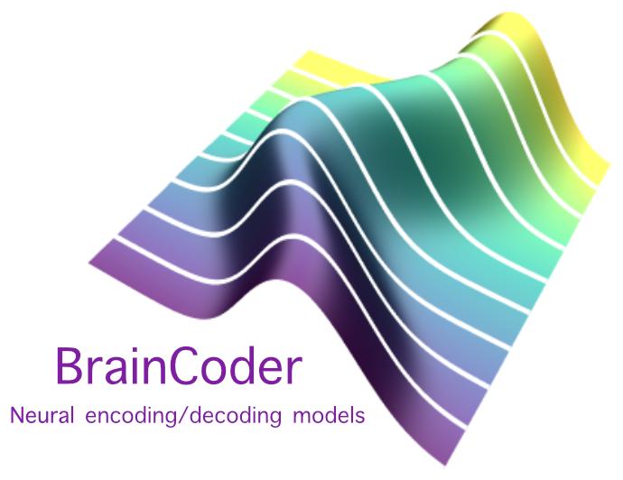

<p align="center">
  <picture>
    <source media="(prefers-color-scheme: dark)" srcset="https://raw.githubusercontent.com/Gilles86/braincoder/main/docs/_static/logo_dark.png">
    
  </picture>
</p>

# Braincoder

[](https://doi.org/10.5281/zenodo.10778413)

**Braincoder** is a package to fit encoding models to neural data (for now fMRI) and
to then *invert* those models to decode stimulus information from neural data. It
wraps stimulus handling, model definition, HRF convolution, and optimization into a
single [Keras 3](https://keras.io)-based toolkit that runs on TensorFlow, JAX, or PyTorch.

## Highlights

- **Composable models.** Pick from ready-made encoding models (Gaussian PRF, HRF-aware, linear) or subclass `EncodingModel` to implement your own.
- **End-to-end workflow.** Utilities for simulation, fitting, and decoding stay in pandas/tensor-friendly formats.
- **Backend-agnostic.** Runs on TensorFlow, JAX, or PyTorch via Keras 3.

## Links

- Source code: https://github.com/Gilles86/braincoder
- Documentation: https://braincoder-devs.github.io/

## Quick start

Install braincoder with one of the three backends:

```bash
pip install "braincoder[tensorflow]"   # or [jax], or [torch]
```

Then predict the responses of two voxels to a stimulus:

```python
import numpy as np
import pandas as pd
from braincoder.models import GaussianPRF

paradigm = pd.DataFrame({"x": np.linspace(-5, 5, 100)},
                        index=pd.Index(np.arange(100), name="time"))
parameters = pd.DataFrame({"mu": [0.0, 1.0], "sd": [1.0, 2.0], "amplitude": [1.0, 1.0], "baseline": [0.0, 0.0]},
                          index=pd.Index(["v1", "v2"], name="voxel"))

model = GaussianPRF()
predicted = model.predict(paradigm=paradigm, parameters=parameters)
```

See the [tutorials](https://braincoder-devs.github.io/tutorial/index.html) for full fitting and decoding pipelines.
Pin the version in your project's environment, e.g. `braincoder[tensorflow]==0.7.1`, so that its results stay reproducible.

## Development install

```bash
git clone https://github.com/Gilles86/braincoder.git
cd braincoder
conda env create -f environment.yml
conda activate braincoder
```

This installs braincoder in editable mode (`pip install -e .`) with a TensorFlow backend and dev tools. See the [installation docs](https://braincoder-devs.github.io/installation.html) for the other backends.

## Using an AI coding assistant

The [braincoder skill](skills/braincoder/SKILL.md) gives an AI coding assistant a step-by-step manual for new projects, the common silent errors, and measured runtimes. It is also readable on its own. In Claude Code, install it with:

```
/plugin install braincoder --marketplace Gilles86/braincoder
```

Other assistants (Codex, Cursor, Gemini CLI, …) can read [`skills/braincoder/SKILL.md`](skills/braincoder/SKILL.md) directly, e.g. by pointing to it from your project's `AGENTS.md`.

## Related software

[prfmodel](https://popylar-org.github.io/prfmodel/) is a Python package for population receptive field modelling, also built on Keras 3. It covers further pRF models, such as CSS, delayed normalization and connective fields.

## How to cite

de Hollander, G., Renkert, M., Ruff, C. C., & Knapen, T. H. (2024). *Braincoder: A package for fitting encoding models to neural data and decoding stimulus features*. Zenodo. DOI: [10.5281/zenodo.10778413](https://doi.org/10.5281/zenodo.10778413).

```bibtex
@software{deHollander2024braincoder,
  author    = {Gilles de Hollander and Maike Renkert and Christian C. Ruff and Tomas H. Knapen},
  title     = {braincoder: A package for fitting encoding models to neural data and decoding stimulus features},
  year      = {2024},
  publisher = {Zenodo},
  doi       = {10.5281/zenodo.10778413},
  url       = {https://github.com/Gilles86/braincoder}
}
```
